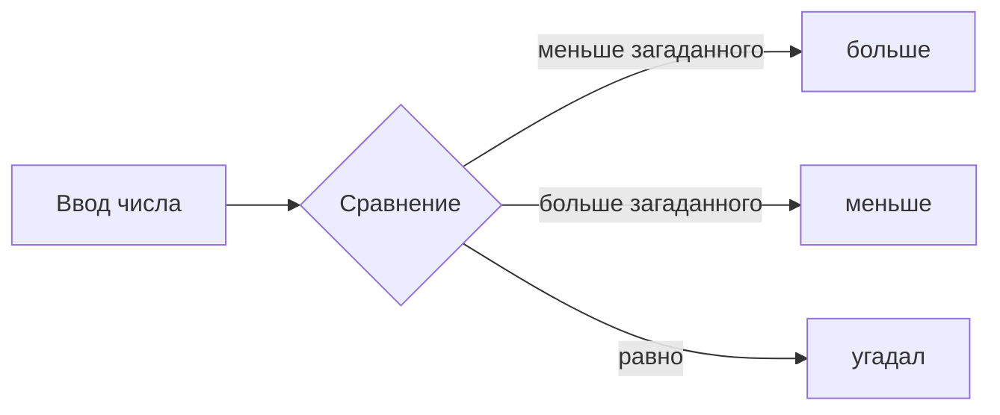

# Угадай число

 

Игра в терминале на тему космоса: бортовой компьютер загадывает число, вы угадываете, а он подсказывает — больше или меньше. Тексты и режимы — в [docs/game.json](docs/game.json), тему можно сменить без кода.

> [!WARNING]
> Нужен Node.js 24.12 или новее.

## Как запустить

```bash
npm install
npm start
npm test
```

`npm install` — один раз, `npm start` — собрать и сыграть, `npm test` — проверить тексты и логику. Выход из игры — Ctrl+C.


## Режимы

| Режим | Диапазон | Подсказки | Победа |
|---|---|---|---|
| quick | 1–10 | мимо, больше / мимо, меньше | молния! |
| classic | 1–100 | выше бери! / ниже бери! | угадал! |

## Как идёт партия



## Что сломалось и как починил

- **Пропала космическая тема.** Хотел отменить один коммит, а набрал `git reset --hard HEAD~2`. Нашёл коммит с темой в `git reflog` и вернул его `git reset --hard HEAD@{1}`.
- **Режим quick попал в main.** Забыл создать ветку и закоммитил прямо в `main`. Сохранил коммит в ветке командой `git branch quick-mode`, а `main` вернул на шаг назад `git reset --hard HEAD~1`.
